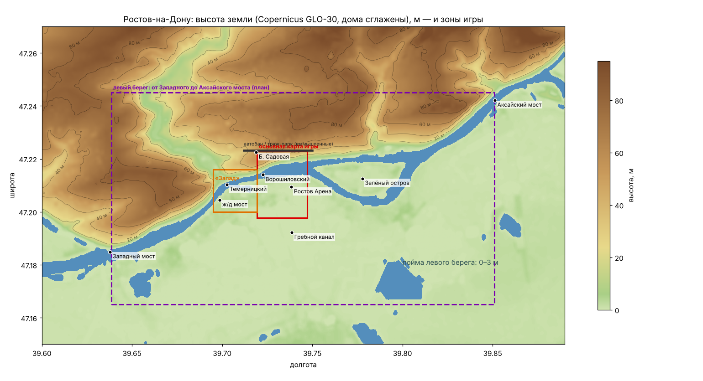

# ТЗ: «Восьмёрка Баклажан» — левый берег, рельеф, порядок в коде

Версия 1 · 25.10.2026 · для одного разработчика (заказчик) и сессий Claude Code.
Связанные документы: `docs/HANDOFF.md` (как устроена игра сейчас), `docs/tz-map.png` (схема района с высотами).



---

## 0. Коротко

| Что | Решение |
|---|---|
| Следующая большая цель | **Левый берег Дона от Западного моста до Аксайского** (~16 км), 2 трассы для гонок и трюков |
| Рельеф | Правый берег — **по настоящим высотам** (данные Copernicus): сейчас холм в игре 38 м, в жизни 55–80 м. Левый берег плоский (0–3 м), горки там — рукотворные: дамбы, насыпи мостов, песчаные дюны |
| Север за Садовой | Позже, отдельным этапом (там сейчас вымышленные автобан, трюк-парк, полигон, «Восьмёрка») |
| Что нельзя потерять | ж/д мост и всё вокруг него, Ростов Арену с трассой внутри, мега-трамплины, трюк-парк, автобан, полигон, «Восьмёрку», Ворошиловский мост, сохранения игроков |
| Как устроить файлы | Основной `index.html` + папки `js/`, `data/`, `maps/` — **подгружаются как скрипты** (так работает и с сайта, и из папки на телефоне). Плюс отдельная сборка «всё в одном файле» |
| Порядок | Этап 0 — порядок в файлах и тестах → 1 — рельеф → 2 — левый берег → 3 — трассы → 4 — красота → 5 — фасады центра → 6 — север |

---

## 1. Что проверено (факты, на которых стоит ТЗ)

### 1.1. Мосты и места (по OpenStreetMap / Nominatim)

| Место | Широта, долгота | В координатах игры (x, z), м* |
|---|---|---|
| Западный мост | 47.1849, 39.6378 | ≈ +7 930, −4 270 |
| ж/д разводной мост (в игре) | 47.2045, 39.6985 | ≈ +3 390, −2 105 |
| Темерницкий мост | 47.2103, 39.7027 | — |
| Ворошиловский мост | 47.2140, 39.7225 | — |
| Ростов Арена | 47.2094, 39.7383 | ≈ +380, −1 565 |
| Гребной канал «Дон» | 47.1922, 39.7385 | ≈ +380, −3 470 |
| Зелёный остров | 47.2126, 39.7777 | ≈ −2 600, −1 210 |
| Аксайский мост | 47.2421, 39.8511 | ≈ −8 150, +2 050 |

\* Игра считает метры от рамки `arcade/refs/rostov-center.osm`, карта повёрнута на 180° (запад → +x, юг → −z). Числа — оценка, точные даст `tools/osm-to-game.py`.

Вывод: левый берег — полоса ~16 × 3–5 км, в 5–8 раз больше всей нынешней карты. Без подгрузки по квадратам не обойтись.
Аксайский мост по x лежит далеко восточнее вымышленной зоны (автобан занимает x −600…+1 400), конфликта нет.

### 1.2. Высоты (Copernicus GLO-30, ячейка 30 м)

Профили «север → юг» (м, после сглаживания домов):

| Долгота | Садовая (47.222) | склон | набережная | Дон | левый берег |
|---|---|---|---|---|---|
| 39.7105 (Будённовский) | 58–63 | 45 → 32 | 6 | 0 | 0–5 |
| 39.7225 (Ворошиловский) | 62–70 | 55 → 37 | 2 | 0 | 0–4 |
| 39.745 (Богатяновка) | 66–74 | 59 → 29 | 3 | 0 | 0–2 |

- Склон правого берега: перепад **55–70 м на 400–700 м**, это уклон 8–14 % (крутые спуски — Богатяновский, Соборный).
- Левый берег от Западного до Аксайского моста: **0–3 м**, плоская пойма с озёрами и протоками. Выше только насыпи (подход Западного моста — ~18 м).
- За Западным мостом правый берег — высокие кручи 70–80 м (Нижнегниловская).
- **Оговорка:** Copernicus — модель поверхности (DSM): в ней есть крыши, деревья, мосты. Чтобы получить землю, берём минимум в окне ~120 м и сглаживаем. Точность ±3–5 м в плотной застройке. Вода в данных ровно 0.
- В игре сейчас: `terrainH()` — придуманный холм высотой 38 м только под основной картой. Сцена «Запад» с ж/д мостом и левый берег — на нуле.

### 1.3. Код сейчас (аудит — раздел 5)

- `arcade/index.html` — 2,85 МБ, 6 864 строки, один общий `<script>`, ~346 глобальных объявлений.
- Из них **~1,95 МБ — данные внутри кода**:

  | Данные | Объём |
  |---|---|
  | карта OSM (основная + «Запад») | 470 КБ |
  | внедорожник | 649 КБ |
  | руль | 381 КБ |
  | машины трафика | 70 КБ |
  | фото неба и текстур | 370 КБ |
  | звуки мотора | 190 КБ |

- Офлайн-сборка `dist/vosmerka-baklazhan/index.html` — **3,63 МБ**. Правило «≤ 3 МБ» из HANDOFF уже нарушено, значит модель «один файл» упёрлась в потолок.

---

## 2. Левый берег: что строим

### 2.1. Границы и состав

- **Рамка:** широта 47.165–47.245, долгота 39.6385–39.851, только суша южнее Дона плюс Зелёный остров. Правый берег здесь не трогаем: он позже, этапами.
- **Что брать из OSM:** дороги и грунтовки, пляжи, лес, луга, озёра, протоки, гребной канал, базы отдыха, Ростов Арена (уже есть), дамбы, ЛЭП (опоры — ориентиры).
- **Заповедник** (не перекрывать, буфер 30 м): Арена, её трасса и мега-трамплины, ж/д мост с подъездами и фарватером, Ворошиловский мост, вся нынешняя основная карта. Контуры выгружает сама игра (как `tools/bridge-export.cjs`) в `maps/protect.json`, а конвейер вырезает внутри них всё новое.

### 2.2. Трассы

**Трасса А «Канал» — кольцо для гонок, 5–6 км, 2 круга, ~3 мин.**
1. Старт на площади у Ростов Арены.
2. Длинная прямая вдоль гребного канала (2,2 км): максималка и «дрэг» с соперниками.
3. Разворот-вираж с наклоном в конце канала.
4. Обратно по другому берегу.
5. Лесной участок Левобережного парка: змейка.
6. Набережная напротив центра: вид на старый город, финиш у Арены.

Трюки: прыжок через протоку (пара трамплинов), песчаный пляж с дюнами, водный «блинчик» по каналу (скольжение по воде на скорости — механика подушки уже есть).
Режимы: гонка с 3 соперниками (код `INNER.race` переносим на «трассу по точкам»), заезд на время с «призраком», задания.

**Трасса Б «Пойма» — ралли из 3 участков по 5–6 км, от Западного до Аксайского моста.**
1. Западный мост → ж/д мост: грунтовки, дамбы, проезд **под** пролётами ж/д моста.
2. Арена → Зелёный остров: пляжи, прыжок через протоку на остров.
3. Остров → Аксайский мост: лес, озёра, финиш-прыжок с насыпи моста.

Под внедорожник: подвеска наконец работает по делу. «Восьмёрка» тоже проходит, но медленнее.
Режимы: на время по участкам, общий зачёт, ключевые точки и рекорды.

**Общее для трасс:**
- трасса описывается данными, а не кодом: линия, ширина, покрытие (асфальт / грунт / песок / вода), контрольные точки, места трамплинов;
- конвейер строит по ним полотно, обочины, ленты-ограждения, стрелки;
- трассы идут по настоящим дорогам OSM, где они есть; где нет — по полям и пляжам с «колеёй».

### 2.3. Рельеф левого берега
Земля 0–3 м по данным высот плюс рукотворное:
- **насыпи мостов** — настоящие высоты, для прыжков;
- **дамбы** — валы 2–4 м вдоль проток (по OSM `man_made=dyke`, если есть, иначе рисуем);
- **дюны** на пляжах — в местах трамплинов на трассах.

---

## 3. Рельеф правого берега

**Задача:** заменить придуманный холм высотой 38 м на настоящие высоты, не сломав мосты и трюки.

1. **Данные:** сетка высот 20 м (или 10 м на склоне) из Copernicus GLO-30: сглаживание домов, вода = 0, набережная = +2 м. Формат — `data/height.js`, значения с шагом 0,25 м: ~0,5 МБ без сжатия, в zip меньше.
2. **Контрольные точки** — таблица из 15–20 мест (Садовая, Театральная, верх и низ спусков, набережная, опоры мостов). Каждая версия проверяется автотестом: ошибка ≤ 3 м.
3. **Заповедник:** под ж/д мостом, у пандусов, на Арене и в трюк-парке высота остаётся прежней, переход плавный на 50–100 м.
4. **Стык с вымышленным севером** (Садовая на 60 м, автобан на 0) — нужно решение:
   - **(а, рекомендую)** вымышленная зона поднимается целиком на «плато» той же высоты, без шва;
   - **(б)** между ними пологий съезд 300 м.
5. **Пересчитать после изменения рельефа:** посадку домов, фонарей и деревьев на склон (`terrainN` уже есть), тени домов, подложку, мини-карту.
6. **Проверки:**
   - все автотесты;
   - аудит ж/д моста (6 174 сценария, 0 провалов);
   - тренажёр 10/10;
   - бюджет кадра на телефоне;
   - кадры «до/после» с 6 точек.
7. **Риск:** на крутых улицах машина разгоняется вниз и не въезжает вверх, трафик тоже. Лечится настройкой сцепления, ограничением крутизны (например, не круче 12 %) или масштабом холма (например, 0,85 от настоящего). Это решаем после пробной сборки.

---

## 4. Ассеты: что взять готовое (бесплатные лицензии)

Принцип: **один стиль на всю игру** — «стилизованный реализм», как сейчас: фото-небо, «живые» цвета, без мультяшности. Чужие модели берём как заготовки и перекрашиваем под нашу палитру в Blender. Только CC0 (или MIT для кода). Без марок и логотипов.

| Что | Источник | Лицензия | Подходит? |
|---|---|---|---|
| Машины трафика | [Kenney Car Kit](https://kenney-assets.itch.io/car-kit) — 40+ моделей, есть glTF | CC0 | Да, для разнообразия трафика (седаны, фургоны, скорая). Мультяшнее наших — сгладить материалом |
| Машины (ещё) | [Quaternius Cars](https://quaternius.itch.io/lowpoly-cars) — FBX/OBJ/Blend | CC0 | Да, через Blender → наш формат. Автобус Quaternius уже в игре |
| Деревья | [Quaternius Textured LowPoly Trees](https://quaternius.itch.io/textured-lowpoly-trees) — 45 деревьев | CC0 | Да, для дальних и средних планов |
| Деревья (свои) | [EZ-Tree](https://github.com/dgreenheck/ez-tree) — генератор деревьев | код MIT; кора с ambientCG CC0; листья — проверить LICENSE | **Лучший вариант для своих пород**: тополь, акация, каштан, ива у воды. Генерируем → запекаем в low-poly и «карточки» |
| Здания-кварталы | [Kenney City Kit Commercial / Suburban / Industrial](https://opengameart.org/content/city-kit-commercial) | CC0 | **Нет** для Ростова (американские дома). Да — для киосков, ангаров, лодочных станций |
| Мелочи города | [KayKit City Builder Bits](https://kaylousberg.itch.io/city-builder-bits) | CC0 | Да: фонари, лавки, урны, знаки (перекрасить) |
| Модульные дома | [Quaternius LowPoly Buildings](https://opengameart.org/content/lowpoly-buildings-pack) | CC0 | Частично — как идеи модулей |
| Текстуры (кирпич, штукатурка, песок, асфальт) | ambientCG, Poly Haven | CC0 | Да, основа для **своего атласа фасадов** |
| Атлас фасадов | готового CC0 «под Ростов» нет | — | **Делаем свой**: 1 картинка 2048², 5 стилей (купеческий кирпич, сталинка, хрущёвка, новостройка, склад) + витрины, двери, карнизы. Рисуем в Blender из CC0-текстур |
| Как строить дома из OSM (идеи) | [Streets GL](https://github.com/StrandedKitty/streets-gl) — 3D-рендер OSM | код MIT; картинки — проверить отдельно | Как образец: крыши, окна, схема Simple 3D Buildings |
| Брызги, дым | своя покадровая анимация, отрендеренная в Blender | своё | Да — так надёжнее по лицензии |
| Звуки (вода, гравий, песок) | Freesound с фильтром CC0, Kenney Audio | CC0 | Да |
| Высоты | Copernicus GLO-30 (бесплатно, с подписью) или SRTM (общественное достояние) | свободная | Да. В титрах: «© DLR e.V. 2010–2014 и © Airbus Defence and Space GmbH 2014–2018, предоставлено в рамках Copernicus ЕС и ЕКА» |
| Карта | OpenStreetMap | ODbL, подпись обязательна | Уже используется |

Каждую модель перед добавлением проверяем на странице автора (лицензия, нет марок). Записываем в `arcade/refs/CREDITS.md`: что, откуда, лицензия, дата.

---

## 5. Аудит кода — как есть и как улучшить

### 5.1. Как устроено сейчас (простыми словами)

Вся игра — один файл `arcade/index.html`:

```
<style>      строки 7–328      — внешний вид меню, кнопок, табло
<разметка>   строки 329–503    — экран: кнопки, мини-карта, меню «⋯»
<script>     строки 505–6864   — вся логика, ~50 разделов подряд:
  520  параметры полигона и города
  532  ДАННЫЕ КАРТЫ (OSM, 250 КБ одной строкой) · 534 сцена «Запад» (221 КБ)
  600  сцена, куски мира по 200 м, небо и свет
  910  земля, автобан, Ростов из OSM, рельеф (1094), трюк-парк
 1665  Ростов Арена, внутри Арены, дрифт-трек «Восьмёрка»
 2385  сцены с подгрузкой · 2421 «Запад» · 2465 ж/д мост · 2942 суда
 3056  режим «Фото», кино-повтор, под водой, PRO, улицы (фонари)
 3475  машина игрока (+ 3849–3850 ДАННЫЕ руля и внедорожника, 1 МБ)
 4253  трафик (+ модели машин) · частицы · вечеринка 888
 4583  состояние, физика полигона, задания, физика езды, езда по стене, полёт
 5536  результаты, меню, уроки, повтор, рекорды, «⋯», карта, тренажёр моста
 6078  звук (+ 7 записей мотора внутри) · управление · приборы
 6508  кадр (главный цикл)
```

**Хорошо:**
- разделы подписаны;
- данные карты собираются скриптами из OSM (повторяемо);
- есть 18 автотестов Playwright с «ручками» `window.__t` (телепорт, замеры) и замер бюджета;
- подробный HANDOFF;
- мир уже умеет подгружать сцены (`SCENES`) и рисовать мелочи по квадратам 200 м.

**Плохо (риски для одного разработчика):**
1. **Данные внутри кода.** Строки по 650 КБ: редактор тормозит, изменения в git нечитаемы, любой пересбор данных — правка «главного файла».
2. **Всё глобальное в одном пространстве.** 346 имён видят друг друга, правка в одном разделе может сломать далёкий (так уже бывало).
3. **Один файл упёрся в потолок:** 3,63 МБ офлайн. Добавить левый берег (ещё 2–5 МБ) некуда, и телефон каждый раз разбирает всё сразу.
4. **Three.js r149 зафиксирован.** Новые версии без «глобальной» сборки. Обновление — отдельный большой шаг, сейчас не нужен.
5. **Тесты разрознены:** 18 скриптов запускаются по одному. Нет одной команды «проверить всё» и общего отчёта. Есть известные нестабильные тесты (меню 8–9/10, бот круга Арены, p1/p2/reach падали и до последних версий).
6. **HANDOFF растёт «хвостом»:** новое дописывается в конец, старые цифры устаревают (например, «~5 300 строк», «≤ 3 МБ»).

### 5.2. Как улучшить (по шагам, без переписывания)

| № | Шаг | Что даёт | Риск |
|---|---|---|---|
| 1 | Вынести данные в `data/*.js` (карта, модели, фото, звуки) | главный файл худеет на 2/3; данные пересобираются отдельно | низкий: механика, проверяется тестами |
| 2 | Разрезать код по разделам на `js/*.js` — те же глобальные имена, тот же порядок | «где что лежит» видно по именам файлов | низкий: копирование без изменения логики |
| 3 | Одна команда проверки `tools/check.sh` (быстрые тесты + бюджет + кадры) с отчётом | перед каждым коммитом — одна кнопка | — |
| 4 | Починить или пометить нестабильные тесты, записать эталон | «красное» значит «сломал я» | средний |
| 5 | `docs/ARCHITECTURE.md` — карта файлов, порядок загрузки, координаты, бюджеты; HANDOFF разделить на «Правила игры», «Устройство», «Журнал» | новичок (и Claude) находит всё за 2 минуты | — |
| 6 | Новые места и трассы — **данными** (`maps/<район>/…`), код только «читает» | новый район без правки движка | средний |
| 7 | (потом) ES-модули + сборщик Vite + новый Three.js | современный стек, WebGPU в будущем | высокий: меняется свет и цвет. Не раньше, чем всё выше |

---

## 6. Файлы: как сделать «по-взрослому», но одному

### 6.1. Важная тонкость
Если открыть игру как файл на телефоне (из папки или zip), браузер **запрещает** читать соседние файлы через `fetch`: так нельзя грузить `.json` и `.glb`. Зато **разрешает подключать `<script src="...">`**. Поэтому все подгружаемые данные упаковываем в `.js`-обёртку вида `GAME.pack("leftbank/3_-7", {...})`. Это работает везде: с сайта, из артефакта claude.ai (там можно публиковать несколько файлов), из папки на телефоне.

### 6.2. Структура

```
arcade/
  index.html                 каркас: стили, разметка, загрузчик, порядок скриптов
  js/                        код по разделам (обычные скрипты, общий порядок)
    core.js  world.js  rostov.js  terrain.js  arena.js  railbridge.js  water.js
    car.js  traffic.js  physics.js  modes.js  missions.js  ui.js  audio.js  frame.js
  data/                      то, что грузится всегда при старте
    osm-main.js  vehicles.js  suv.js  wheel.js  photos.js  sounds.js  height.js
  maps/                      подгружается при подъезде (по квадратам 500 м)
    west/…  leftbank/tile_+03_-07.js …  tracks/canal.js  tracks/poyma.js
    protect.json → protect.js  (заповедник)
  vendor/three.min.js        (r149, для офлайна)
tools/build.py →
  dist/web/                  папкой: для артефакта, сайта, zip «папка»
  dist/single/index.html     всё в одном файле (как сейчас) — запасной вариант
```

### 6.3. Где играть на телефоне
- **Сейчас:** артефакт claude.ai (многофайловый — поддерживается) плюс zip.
- **Опция «как приложение»:** бесплатный хостинг (GitHub Pages, Cloudflare Pages, Netlify) и PWA: игра ставится иконкой на Android и работает без сети после первого запуска. Плюс: обновления приходят сами. Минус: нужен хостинг и проверка доступности из России. Решить позже.

### 6.4. Бюджеты (новые)

| Что | Лимит |
|---|---|
| Кадр | ≤ 150 тыс. треугольников, ≤ 120 вызовов отрисовки (как было) |
| Старт | `index.html` + `js/` + `data/` ≤ 4 МБ; первый кадр на телефоне ≤ 4 с |
| Квадрат карты 500 м | ≤ 300 КБ, ≤ 15 вызовов, ≤ 25 тыс. треугольников |
| Видимых квадратов одновременно | ≤ 9 вблизи + дальний фон (1–2 вызова) |
| Память | ≤ 400 МБ на телефоне; дальние квадраты выгружаются |
| Далеко от начала координат (до ±9 км) | точности хватает, но при дрожании камеры — «плавающий центр» мира |

---

## 7. Этапы (каждый — отдельная проверяемая версия)

| Этап | Результат | Готово, когда… |
|---|---|---|
| **0. Порядок** | данные → `data/`, код → `js/`, две сборки, `tools/check.sh`, ARCHITECTURE.md | игра выглядит и играется так же; все прежние тесты как до этапа; кадры совпадают; офлайн-zip работает |
| **1. Рельеф** | `data/height.js` по Copernicus, контрольные точки, плато севера | ошибка ≤ 3 м по точкам; аудит моста 0 провалов; тренажёр 10/10; бюджет кадра в норме |
| **2. Левый берег — основа** | выгрузка OSM по квадратам, конвейер `osm-to-game` → `maps/leftbank/`, подгрузка, заповедник, земля, вода, лес, дороги | проезд от Западного до Аксайского моста без провалов и рывков; ≤ 120 вызовов; Арена и мост целы |
| **3. Трассы** | «Канал» (кольцо, соперники) и «Пойма» (3 участка) | оба заезда проходятся ботом; рекорды сохраняются; задания |
| **4. Красота** | деревья (EZ-Tree / Quaternius), вода (глубина, пена, рябь, блики), брызги, запечённые тени, туман-перспектива | кадры «до/после»; бюджет; телефон ≥ 30 к/с |
| **5. Центр** | атлас фасадов, крыши, 8–10 ориентиров | узнаваемость по кадрам |
| **6. Север за Садовой** | перенос или объединение вымышленных зон, новый район | — |

---

## 8. Первые промпты (копировать в новую сессию целиком)

Общая шапка для каждого (вставлять первой):

```
Проект «Восьмёрка Баклажан» (репозиторий AnimalDesign, ветка ccr-db926758-gzqv44).
Прочитай docs/TZ.md и docs/HANDOFF.md. Работаем строго по этапу ниже, ничего сверх него.
Рамки: телефон Android в портрете — главный экран; кадр ≤150 тыс. треугольников и ≤120 вызовов;
только CC0/MIT-ассеты, без брендов; сохранение localStorage["baklan3d-v1"] не ломать;
у артефакта не объявлять capabilities. После этапа: тесты, сборка, коммит, пуш,
обновить артефакт и zip, отчёт по-русски: сделано / проверено / не проверено.
```

**Промпт 1 — Этап 0, шаг «данные наружу»**
```
Этап 0.1. Вынеси все большие данные из arcade/index.html в arcade/data/*.js
(OSM-DATA, WEST-DATA, MODELS-DATA, SUV_DATA, WHEEL_DATA, PHOTO_*, записи мотора) —
обёрткой, которая работает и с file:// (подключение <script src>, без fetch).
Поправь tools/osm-to-game.py, build-suv.py, build-wheel.py, obj-to-game.py, чтобы писали в новые файлы.
tools/build-offline.py: две сборки — dist/web/ (папкой) и dist/single/index.html (всё в одном).
Логику игры не меняй. Докажи равенство: все тесты как до изменений (сначала сними эталон),
кадры из 6 точек совпадают попиксельно, офлайн-zip открывается из папки.
```

**Промпт 2 — Этап 0, шаг «код по файлам и одна проверка»**
```
Этап 0.2. Разрежь <script> из arcade/index.html на arcade/js/*.js по существующим разделам
(/* ---------- … ---------- */), сохранив порядок и глобальные имена — без изменения логики.
Сделай tools/check.sh: быстрые тесты, замер бюджета (tools/arcade-perf.cjs, оба авто, кабина),
кадры из 6 точек и сводный отчёт. Отметь нестабильные тесты, запиши эталон.
Напиши docs/ARCHITECTURE.md: файлы, порядок загрузки, система координат, бюджеты, как добавить район.
Раздели HANDOFF: правила игры / устройство / журнал. Проверка — как в этапе 0.1.
```

**Промпт 3 — Этап 1, рельеф**
```
Этап 1. Рельеф правого берега по настоящим высотам (docs/TZ.md, раздел 3).
Источник — Copernicus GLO-30 (тайл N47 E039 с copernicus-dem-30m.s3.amazonaws.com).
Сними дома (минимум в окне ~120 м + сглаживание), вода = 0, набережная = +2 м.
Сетка 20 м (10 м на склоне) → arcade/data/height.js; скрипт сборки в tools/.
Заповедник (ж/д мост, Арена, трюк-парк) — высота прежняя, плавный переход.
Стык с вымышленным севером — вариант (а) «плато», если не скажу иначе.
Сначала покажи мне кадры и таблицу контрольных точек (игра vs данные) — до коммита.
Потом: все тесты, bridge-audit (0 провалов), тренажёр 10/10, бюджет кадра.
```

**Промпт 4 — Этап 2а, разведка левого берега (без кода игры)**
```
Этап 2а. Разведка левого берега от Западного до Аксайского моста (рамка в docs/TZ.md, 2.1).
Скачай OSM квадратами через api.openstreetmap.org (Overpass закрыт), склей,
дотяни отношения целиком (tools/osm-add-relations.py). Посчитай: дороги/грунтовки по типам,
пляжи, лес, озёра, протоки, дамбы, дома. Нарисуй схему (как docs/tz-map.png) с этим
и предложи точные линии трасс «Канал» и «Пойма» по настоящим дорогам: длины, покрытия,
места трамплинов, проезд под мостами. Оцени объём данных по квадратам 500 м.
Код игры не меняй. Результат — docs/leftbank-plan.md + картинки, на мое утверждение.
```

**Промпт 5 — Этап 2б, левый берег в игре**
```
Этап 2б. По утверждённому docs/leftbank-plan.md: конвейер osm-to-game → maps/leftbank/ квадратами 500 м,
подгрузка через существующий SCENES, заповедник maps/protect.js (выгрузить из игры).
Земля, вода, лес (пока простые деревья), дороги, редкие постройки. Бюджеты из docs/TZ.md, 6.4.
Бот-проезд от Западного до Аксайского моста: без провалов, рывков подгрузки > 50 мс, ≤120 вызовов.
Проверить, что Арена, ж/д мост, задания и рекорды не изменились.
```

**Промпт 6 — Этап 3, трасса «Канал»**
```
Этап 3а. Трасса «Канал» (docs/TZ.md, 2.2) как данные maps/tracks/canal.js: линия, ширина,
покрытие, контрольные точки, трамплины. Обобщи код гонки INNER.race до «трассы по точкам»,
не сломав Гран-при Арены. Огни старта, 3 соперника, 2 круга, рекорд, «призрак», 2 задания.
Бот проходит заезд на обеих машинах; Гран-при Арены — как раньше.
```

---

## 9. Открытые вопросы к заказчику
1. Стык Садовой с автобаном — «плато» (рекомендую) или съезд?
2. Если настоящий холм окажется слишком крут для езды — разрешаешь масштаб 0,85 или ограничение 12 %?
3. Нужен ли хостинг с установкой иконкой (PWA) или пока хватает артефакта и zip?

## Источники
- [Kenney Car Kit](https://kenney-assets.itch.io/car-kit) · [Kenney City Kit Suburban](https://kenney-assets.itch.io/city-kit-suburban) · [City Kit Commercial](https://opengameart.org/content/city-kit-commercial) · [City Kit Industrial](https://opengameart.org/content/city-kit-industrial)
- [KayKit City Builder Bits](https://kaylousberg.itch.io/city-builder-bits) · [Quaternius LowPoly Buildings](https://opengameart.org/content/lowpoly-buildings-pack) · [Quaternius Cars](https://quaternius.itch.io/lowpoly-cars) · [Quaternius Textured Trees](https://quaternius.itch.io/textured-lowpoly-trees)
- [EZ-Tree](https://github.com/dgreenheck/ez-tree) · [Streets GL](https://github.com/StrandedKitty/streets-gl) · [Streets GL (OSM wiki)](https://wiki.openstreetmap.org/wiki/Streets_GL)
- Высоты: Copernicus DEM GLO-30, `copernicus-dem-30m` (AWS Open Data). Места: Nominatim / OpenStreetMap.
